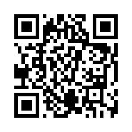

# Soutenir UltraTransfert

UltraTransfert est un logiciel libre sous licence MIT. Le don est facultatif :
aucune fonction n'est payante, aucun portefeuille n'est ouvert automatiquement,
aucune transaction n'est construite ou envoyée par le logiciel.

**Adresse BTC, réseau Bitcoin uniquement :**

`3HaGinyFJQJXFAMgU8SBuDxdS5aG5BQUNU`

Le QR encode exactement `bitcoin:3HaGinyFJQJXFAMgU8SBuDxdS5aG5BQUNU`, sans montant,
intermédiaire ni URL de paiement. L'adresse complète reste visible et copiable
dans l'application. Vérifier l'adresse dans le portefeuille avant tout envoi.

L'adresse passe Base58Check et le QR a été relu avec un décodeur indépendant
(zxing-cpp). Ces vérifications ne prouvent pas la propriété du portefeuille.
Le QR de la capture fournie contenait cette même URI ; aucune capture personnelle
n'est incluse dans la distribution. Les dons ne sont pas des achats de support
et ne promettent aucune déductibilité fiscale.
