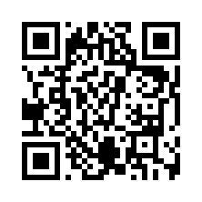

# UltraTransfert

Logiciel open source de transfert de fichiers avec reprise après interruption et
vérification SHA-256. Version **0.4.1 bêta**, licence [MIT](LICENSE).

## Fonctions

- Copier des dossiers entre disques, clés USB et partages réseau accessibles.
- Partager et recevoir un dossier en HTTPS avec une invitation et un certificat épinglé.
- Interrompre puis reprendre une copie et vérifier les fichiers avant d'annoncer sa réussite.
- Régler une limite de vitesse et consulter un bilan en français.
- Essayer une compression sans perte adaptative ou prédictive, facultative en HTTPS.

La compression prédictive R2.2 et la lecture R3.1 sont intégrées à l'installateur.
Les résultats de recherche concernent des scénarios synthétiques : aucune
supériorité générale ni compression révolutionnaire n'est démontrée.

## Installation Windows

Le workflow [Build and validate Windows installer](.github/workflows/windows-validation.yml)
construit l'installateur autonome et le teste sur Windows Server 2022 et 2025.
Consulter **Actions** pour l'état réel du dernier commit et ses rapports ;
un workflow préparé ou lancé ne constitue pas une validation réussie.

L'installateur inclut Python, une interface française, des raccourcis et une
désinstallation par utilisateur. Les fichiers de test sont disponibles dans
l'artefact `windows-installer` lorsqu'une compilation réussit.

**Bêta non signée.** Les tests Windows Server ne prouvent pas Windows 10/11,
le comportement SmartScreen après téléchargement, ni une véritable session RDP.
Aucune absence générale d'alertes antivirus n'est garantie. Ne désactivez pas
vos protections pour exécuter le programme.

## Lancer depuis les sources

Python 3.10+ et tkinter sont nécessaires. Depuis la racine du projet :

```sh
python -m pip install .
python -m ultra gui
```

Le partage HTTPS nécessite le complément `cryptography` :

```sh
python -m pip install '.[sharing]'
```

Pour les options et les modes de compression : `python -m ultra --help`.
Les lanceurs Windows et les guides détaillés sont également fournis.

## Développement et validation

```sh
python -m compileall -q ultra
python -m unittest discover -s tests -v
```

Le test de compatibilité utilise une référence historique conservée dans
`history/v0.3.7/ultra/compression.py`. Les anciens paquets, environnements,
rapports de session et dépendances téléchargées ne font pas partie du dépôt.

Voir [construction de l'installateur](CONSTRUCTION_INSTALLATEUR.md),
[validation Windows et RDP](VALIDATION_WINDOWS_RDP.md),
[sécurité](SECURITY.md) et [contribution](CONTRIBUTING.md).

## RDP

La copie peut utiliser un lecteur redirigé accessible dans une session RDP.
`Tester_RDP.bat` prépare un essai avec données synthétiques dans une session
Windows réelle. Le canal RDP natif et la reprise entre transports restent
à développer ; aucun résultat RDP réel n'est revendiqué ici.

## Soutenir le projet

Les dons sont facultatifs et ne déverrouillent aucune fonction.

Adresse Bitcoin : `3HaGinyFJQJXFAMgU8SBuDxdS5aG5BQUNU`



Voir [DONS_BITCOIN.md](DONS_BITCOIN.md).
